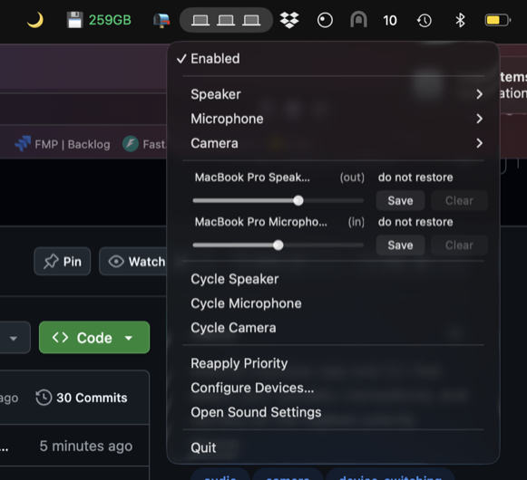

# Device Priority Sanitizer




Keeps your speaker, microphone, and camera on the device you actually want —
automatically, and independently for each target. A native macOS menubar app
with a full CLI.

## Why not just use macOS device selection?

macOS has no notion of an ordered priority list. Device selection is a manual,
per-device choice, and when devices connect or disconnect the defaults can
drift to the built-in hardware, a virtual device, or whatever was selected
last.

Device Priority Sanitizer adds:

- **Ordered priority tiers** — first matching device wins (e.g. headset before
  speaker before built-in)
- **Fully independent targets** — output, input, and camera each have their
  own priority list and device set
- **Automatic re-evaluation** whenever the connected device set changes
- **Stability within a tier** — equivalent devices (several headsets) never
  churn into each other
- **Manual overrides that persist** — a manual pick stays until that target's
  device set changes, then auto-selection resumes
- **Synthetic devices are left alone** — virtual, aggregate, AirPlay, and Desk
  View devices are recognised and never auto-selected
- **Per-device saved volume levels**, restored whenever a device is activated
- **Camera prioritization** via the macOS system-preferred camera (apps that
  follow the system default pick it up)
- **Sound effects follow the output** — alerts and beeps play on the active
  speaker, like changing the device in System Settings does
- **Menubar UI plus a scriptable CLI** for hotkeys and automation

## How it works

Define ordered tiers as name-matching rules per target. On startup and
whenever the connected device set changes, the app selects the
highest-priority connected device for each target and applies it — including
the sound-effects device for output. Manual picks (`set`, `cycle`) are
respected until that target's device set changes again; `reapply` forces the
configured priority at any time.

## Installation

### Package (GitHub Releases)

Requires macOS 26 (Tahoe) or newer on Apple Silicon. The installer is
**unsigned**, so macOS shows a Gatekeeper warning the first time the app is
opened: use **System Settings → Privacy & Security → Open Anyway**, or remove
the quarantine flag before opening:

```
xattr -d com.apple.quarantine DevicePrioritySanitizer-<version>.pkg
```

Verify the download before installing:

```
cd <download directory>
shasum -a 256 -c DevicePrioritySanitizer-<version>.pkg.sha256
```

The installer installs:

- `/Applications/Device Priority Sanitizer.app`
- `/usr/local/bin/device-priority-sanitizer` — a symlink to the app binary;
  `/usr/local/bin` is already on the default `PATH`

After installing, launch the app from `/Applications` and configure it from
the menubar (`Configure Devices…`) or with `device-priority-sanitizer config`.
To start it at login, add the app under **System Settings → General → Login
Items**. The installer does not enable autostart.

Uninstall:

```
device-priority-sanitizer stop
sudo rm -rf "/Applications/Device Priority Sanitizer.app"
sudo rm -f /usr/local/bin/device-priority-sanitizer
sudo pkgutil --forget alex.device-priority-sanitizer
```

Runtime state under
`~/Library/Application Support/device-priority-sanitizer/` and
`~/Library/Logs/device-priority-sanitizer/` is kept unless you delete it.

### Home Manager

If you already use Nix, the flake also exposes a Home Manager module
(`homeManagerModules.default`) that installs the same app/CLI and, when
autostart is enabled, a launchd agent. Use either the installer **or** the
Home Manager module — not both: the config path is shared. The Home Manager
module also installs Raycast script commands; the installer does not.

## CLI

```
device-priority-sanitizer list [output|input|camera] [--json]
device-priority-sanitizer current [output|input|camera]
device-priority-sanitizer set <output|input|camera> <name>
device-priority-sanitizer set <output|input|camera> --tier <title>
device-priority-sanitizer cycle <output|input|camera>
device-priority-sanitizer reapply
device-priority-sanitizer enable | disable
device-priority-sanitizer status [--json]
device-priority-sanitizer start | stop
device-priority-sanitizer volume get <output|input>
device-priority-sanitizer volume set <output|input> <0…1>
device-priority-sanitizer volume save <output|input>
device-priority-sanitizer volume clear <output|input>
device-priority-sanitizer volume show [--json]
device-priority-sanitizer config
```

- `set` resolves a device by exact name first, then case-insensitive
  substring; ambiguity exits with a candidate list.
- `set --tier` picks the best currently connected device in a configured
  tier — the same rules auto-selection uses.
- `cycle` advances to the next managed device in menu order (wrapping,
  synthetic devices skipped) — ideal for a headset↔speaker hotkey.
- `enable`/`disable` toggle prioritization globally without touching manual
  picks; `status` reports the current switch and configured tiers.
- `start`/`stop` control the menubar app itself, honoring whichever
  supervisor owns it (launchd agent or manual launch).
- `volume save`/`clear` manage the per-device levels that are restored on
  every activation; `volume show` inspects the store.

## Configuration

- Configure tiers, fallback symbols, and sound-effects mirroring in the
  configuration window (menubar *Configure Devices…* or `config`). Priority
  is drag-and-drop; an empty priority list leaves that target unmanaged.
- Configuration lives at
  `~/Library/Application Support/device-priority-sanitizer/config.json`;
  runtime state (`state.json`) and saved levels (`levels.json`) sit next to
  the config and are owned by the app.
- On a Home Manager install the config file is a read-only store symlink;
  the Nix module is then the source of truth, and the configuration window
  opens read-only.
- The global prioritization switch is menubar/CLI-only and independent of the
  configuration.
- Agent log: `~/Library/Logs/device-priority-sanitizer/agent.log`.

## License

MIT — see [LICENSE](LICENSE).
